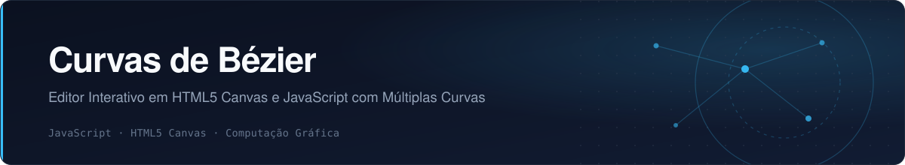

<p align="center">
  
</p>

<p align="center">
  
  
  
</p>

## Sobre o Projeto

Aplicação web interativa para criação e manipulação de **Curvas de Bézier** diretamente em **HTML5 Canvas**, permitindo trabalhar com múltiplas curvas simultâneas, editar pontos de controle com o mouse e configurar a resolução da curva em tempo real.

## Funcionalidades e Controles

| Ação | Como fazer |
| :--- | :--- |
| **Adicionar ponto de controle** | Clicar em qualquer região do canvas |
| **Mover ponto de controle** | Segurar e arrastar o ponto com o mouse |
| **Apagar ponto de controle** | Dar dois cliques sobre o ponto |
| **Gerenciar curvas** | Usar os botões **Adicionar Curva**, **Deletar Curva** e **Trocar Curva** |
| **Camadas visuais** | Marcar/desmarcar **Pontos**, **Poligonal** e **Curva** |
| **Número de avaliações** | Editar o valor inteiro no campo de texto (padrão: `1000`) e pressionar `Enter` ou clicar no canvas |

## Como Executar

Não precisa de build ou servidor — basta clonar e abrir `index.html` no navegador:

```bash
git clone https://github.com/charles-gabriel-cc/Curvas-de-b-zier.git
```

## Autores

- **Grupo:** `nbmcd`, `cgcc` (Charles Gabriel)
